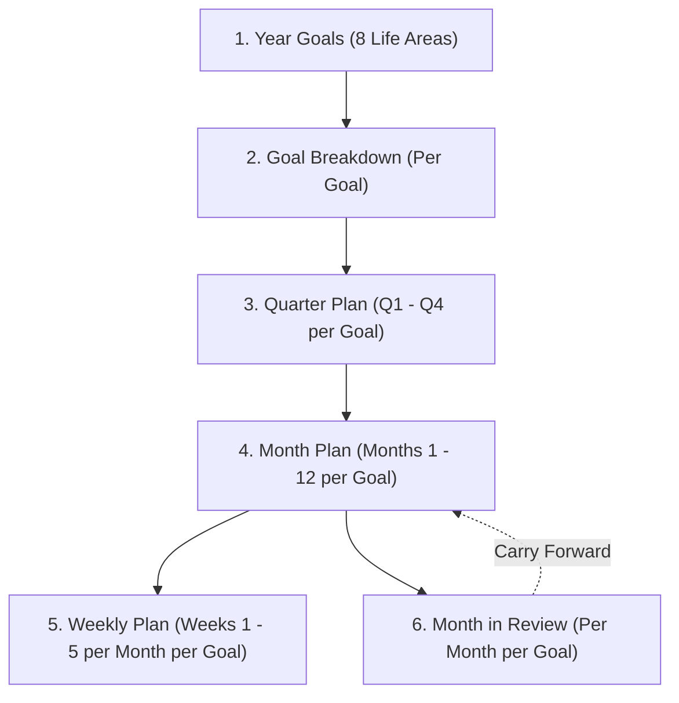

# Reflective E-Journal (Mobile & Web)

A mindful, structured digital journal application built with **React Native (Expo)** and **TypeScript**, designed for both **cross-platform mobile (iOS & Android)** and **responsive web**.

Inspired directly by the tactile elegance of physical paper journals, this application translates quarterly planning, habit tracking, and deep self-reflection into a fluid digital experience with a **full goal-by-goal cascading hierarchy**.

---

## 🏛️ Goal-Specific Cascading Hierarchy

Every annual goal you set operates as its own dedicated journey with nested quarters, months, and weeks:



### The 5 Cascading Levels:
1. **Year Goals**: Overview of your 8 holistic life areas, 3-circle priority ranker (`Priority ○ ○ ○`), and your top 3 circled goals.
2. **Goal Breakdown**: For each goal &rarr; *Why it matters to me*, quarterly milestones (Q1, Q2, Q3, Q4), and *Support I need*.
3. **Quarter Plans (Q1, Q2, Q3, Q4)**: For each goal &rarr; *Quarter theme* and 3 monthly checkpoint targets with completion checkboxes.
4. **Month Plans (Months 1 to 12)**: For each goal &rarr; *5 key goals for the month*, *6 to-dos*, and *reflective notes*.
5. **Weekly Planners (Weeks 1 to 5 for each month)**: For each goal &rarr; *Week of*, *My top 3 priorities this week*, Monday through Sunday daily actions, and *Carry forward*.
6. **Month in Review (For each month)**: For each goal &rarr; *What I achieved*, *What was left undone*, *What got in the way*, *Carry forward items*, and reflections (*One win*, *One lesson*, *Grateful for*).

---

## 🌸 Visual Aesthetic & Paper Touch

- **Paper & Editorial Warmth**: Soft cream linen background (`#FAF7F2`), delicate card borders, and notebook-ruled lines.
- **Botanical Accents**: Hand-crafted SVG floral motifs echoing the physical journal's illustrations.
- **Goal Scope Header**: Instant breadcrumbs (e.g. `Personal growth > Q1 > January > Week 1`) and a 1-tap horizontal goal switcher on every screen.
- **Curated Wisdom**: Authentic quotes from Helen Keller, Charles R. Swindoll, African proverbs, Maya Angelou, Nelson Mandela, and Lao Tzu.
- **Offline-First & Private**: Your journal data is stored locally via `AsyncStorage`. Includes JSON export & import.

---

## 🚀 Getting Started

### Prerequisites
- Node.js (v18+ recommended)
- npm or yarn

### Installation
Dependencies are already installed. If setting up on a new machine:
```bash
npm install
```

### Running the App

#### 1. In your Web Browser
```bash
npm run web
```
Opens instantly at `http://localhost:8081` with responsive layout (mobile phone frame on desktop or fluid full screen).

#### 2. On Mobile (iOS & Android)
Install the free **Expo Go** app on your phone from the Apple App Store or Google Play Store.

Then run:
```bash
npm start
```
Scan the displayed QR code with your phone camera (iOS) or the Expo Go app (Android). The journal will load natively on your phone!

---

## 📁 Project Architecture

```
e-journal/
├── assets/                  # App icons and favicon
├── src/
│   ├── components/          # Reusable journal UI elements
│   │   ├── CheckboxItem.tsx     # Custom paper checkbox with strike-through
│   │   ├── FloralHeader.tsx     # Botanical header with SVG flowers
│   │   ├── GoalScopeHeader.tsx  # Goal breadcrumbs & 1-tap goal switcher
│   │   ├── JournalBox.tsx       # Lined/card input container
│   │   ├── PrioritySelector.tsx # 3-circle priority ranker & top 3 badge
│   │   └── QuoteFooter.tsx      # Curated quotes matching physical book
│   ├── constants/
│   │   ├── quotes.ts            # Book quotes and authors
│   │   └── theme.ts             # Warm paper palette, typography & shadows
│   ├── navigation/
│   │   └── JournalNavBar.tsx    # Responsive bottom/desktop tab navigation
│   ├── screens/
│   │   ├── YearGoalsScreen.tsx     # Screen 1 (Photo 1)
│   │   ├── GoalBreakdownScreen.tsx # Screen 2 (Photo 3)
│   │   ├── QuarterPlanScreen.tsx   # Screen 3 (Photo 4)
│   │   ├── MonthPlanScreen.tsx     # Screen 4 (Photo 5)
│   │   ├── WeekPlanScreen.tsx      # Screen 5 (Photo 6)
│   │   ├── MonthReviewScreen.tsx   # Screen 6 (Photo 2)
│   │   └── SettingsScreen.tsx      # Backup, Restore, Year, Print
│   ├── storage/
│   │   └── journalStorage.ts    # Nested state management & updaters
│   └── types/
│       └── journal.ts           # Goal, Quarter, Month, Week schemas
├── App.tsx                  # Root component with state synchronization
├── app.json                 # Expo configuration
├── package.json             # Dependencies & scripts
└── tsconfig.json            # TypeScript configuration
```
